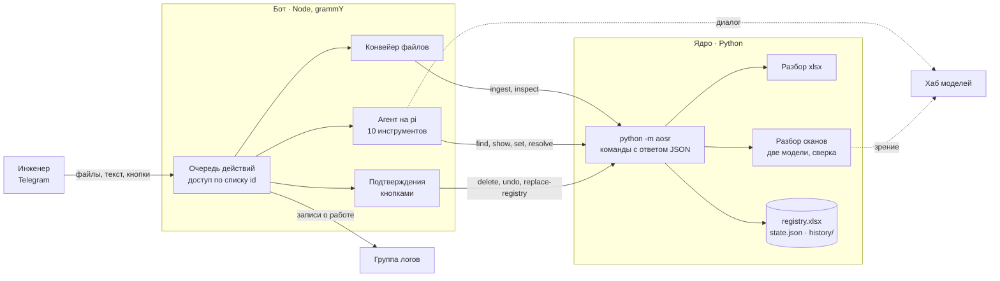

# АОСР → реестр: помощник по исполнительной документации

Telegram-бот для инженера на стройке. Ему присылают акты освидетельствования скрытых работ (АОСР) — книгой
Excel или сканом PDF — и получают обратно обновлённый накопительный реестр исполнительной документации.
Сомнительные места бот уточняет кнопками, а реестр можно править словами: «исправь дату в акте ВО/4-9/ОЗ»,
«какие акты были в августе?».

Главная идея: **модель разговаривает, но в реестр не пишет**. Каждую ячейку записывает детерминированный код,
а необратимые действия выполняются только после нажатия кнопки человеком.

## Что умеет

- **Разбор актов из Excel.** Книга «один лист — один акт»: номер, дата, работы, коды по ведомости, объёмы,
  единицы, место, приложения. За один файл — десятки актов.
- **Разбор сканов.** PDF читают две модели со зрением независимо; где они расходятся, бот задаёт вопрос
  с двумя вариантами и кнопкой «напишу сам».
- **Накопительный реестр.** Акты сортируются по дате, дубли определяются по номеру, чужие строки и ручные
  колонки реестра сохраняются. Реестр, правленный в Excel, можно прислать обратно — правки запомнятся.
- **Диалог.** Найти и показать акт, исправить поле, удалить акт, отменить последнее изменение, ответить
  на открытый вопрос — обычным текстом.
- **Память о правках.** Ручное исправление переживает повторную загрузку того же акта; удалённый акт
  сам не возвращается.
- **Отмена.** Каждое изменение хранит предыдущую версию реестра (до 50 шагов).
- **Журнал в Telegram-группу.** Кто что прислал, какие инструменты вызвал агент, что ответил бот, ошибки.

## Архитектура



Три слоя с жёсткими границами:

| Слой | Что делает | Чего не может |
|---|---|---|
| **Ядро** (`aosr/`, Python) | разбирает акты, ведёт реестр, вопросы, историю; единственный, кто пишет в `registry.xlsx` | ничего не знает о Telegram и диалоге |
| **Бот** (`bot/src/`, TypeScript) | доступ, очередь, файлы, кнопки, отчёты, журнал; вызывает ядро как процесс | не разбирает акты сам |
| **Агент** (pi + модель через хаб) | понимает просьбу и вызывает инструменты-обёртки над командами ядра | нет доступа к файлам и оболочке; удаление, отмену и замену реестра только запрашивает |

### Как устроена безопасность данных

- **Запись — только кодом.** Модель со скана лишь переписывает текст; коды, объёмы, единицы и место выделяет
  тот же код, что и для Excel.
- **Необратимое — по кнопке.** Удаление акта, отмена изменения, замена реестра и замена акта при конфликте
  выполняет код бота после нажатия; слова «подтверждение не нужно» кнопку не отменяют.
- **Проверка заявлений модели.** Если модель написала «удалил», а реестр не менялся, бот дописывает поправку.
- **Доступ.** Бот отвечает только разрешённым Telegram-id и только в личном чате.
- **Секреты.** Токен бота и ключ хаба берутся из связки ключей macOS в момент запуска; в репозитории,
  настройках и журналах их нет.

## Состояние

| Часть | Проверка |
|---|---|
| Ядро | 128 тестов, сеть не нужна |
| Бот | 103 теста, сеть не нужна |
| Диалог на живой модели | 14 сценариев × 3 прогона: 42 из 42, опасные сценарии 15 из 15 — прогон на документах реального объекта (`bot/eval/RESULT.md`) |

Работает как служба launchd на macOS. CI и развёртывание на сервере не настроены.

## Что где лежит

```
aosr/        ядро: разбор актов, реестр, вопросы, история, команды
bot/         бот: src/ — код, test/ — тесты, eval/ — сценарии диалога, agent-home/ — настройки моделей
tests/       тесты ядра и записанные ответы моделей на скан
scripts/     установка службы, сквозная проверка, запись эталона скана, сборка примеров
examples/    синтетические шаблон реестра, книга актов и PDF акта
deploy/      шаблон службы launchd
docs/        проект решения и планы работ
spikes/      пробы: модели со зрением, агент на pi
```

Проект решения: `docs/superpowers/specs/2026-11-14-reestr-agent-design.md`.

### Про данные

Бот сделан для инженера на реальной стройке и отлажен на его документах. Этих документов в репозитории нет.
В `examples/` лежат синтетические файлы той же раскладки: 12 актов, шаблон реестра и PDF одного акта. Объект,
организации, номера, даты и объёмы в них выдуманы; их собирает `scripts/make_examples.py`. Записанные ответы
моделей в `tests/fixtures/scan_example/` — настоящие ответы на настоящий скан, в которых номера, даты, пикеты
и объёмы заменены. Ошибки распознавания («3.2.1.4» вместо «3.2.1.5», лишняя буква в номере протокола) оставлены
как были: на них держатся тесты сверки. Свои документы кладите в `input/`, результаты — в `out/`: обе папки
в git не попадают.

# Ядро

## Установка

```sh
python3 -m venv .venv && .venv/bin/pip install -e '.[dev]'
.venv/bin/pytest -q            # ~10 секунд; сеть и ключи не нужны
```

Тесты идут на примерах из `examples/`.

### Модели

Модели нужны для сканов (ядро) и для диалога (бот); книги Excel разбираются без них. По умолчанию всё
настроено на хаб neuraldeep, но подойдёт любой сервис с OpenAI-совместимым
`/chat/completions`:

| Что | Как задать | По умолчанию |
|---|---|---|
| ключ | `NEURALDEEP_API_KEY`, иначе вывод команды из `NEURALDEEP_KEY_CMD` | `~/.local/bin/neuraldeep-hub-key` |
| адрес для сканов | `AOSR_LLM_BASE_URL` | `https://api.neuraldeep.ru/v1` |
| две модели со зрением | `AOSR_SCAN_PRIMARY`, `AOSR_SCAN_SECONDARY` | `qwen3.6-fp8-noreason`, `qwen3.8-27b-noreason` |
| модель диалога | `bot/agent-home/models.json` (адрес, ключ, список моделей) и поле `model` в настройках бота | `qwen3.6-fp8-noreason` |

Две модели для сканов должны быть разными: смысл сверки в том, что они ошибаются в разных местах.

## Команды

`python -m aosr --home ПАПКА <команда>` — каждая печатает один JSON-объект: `{"ok": true, …}` или
`{"ok": false, "error": {"code": "…", "message": "…"}}` с кодом выхода 1.

| Команда | Что делает | Главное в ответе |
|---|---|---|
| `init --template ФАЙЛ` | чистый реестр из шаблона | — |
| `ingest ФАЙЛ…` | разобрать акты (xlsx, pdf) и внести | `added`, `updated`, `total`, `issues`, `open_issues`, `notes`, `errors` |
| `find [--number] [--text] [--from] [--to]` | поиск; текст сравнивается по основам слов | `acts`, `count` |
| `show НОМЕР` | акт целиком | `act` (поля, приложения, ручные колонки, вопросы) |
| `set НОМЕР ПОЛЕ ЗНАЧЕНИЕ` | исправить поле | `old`, `new` |
| `delete НОМЕР` / `restore НОМЕР` | удалить акт / разрешить ему вернуться при следующей загрузке | `removed_rows` |
| `issues [--number]` | открытые вопросы | `issues`, `open` |
| `resolve ВОПРОС ОТВЕТ [--literal]` | ответить: `1`, `2` или своё значение; с `--literal` ответ всегда значение, даже «1» | `field`, `value` |
| `replace-registry ФАЙЛ [--missing check\|keep\|drop]` | принять реестр, правленный в Excel | `missing` либо `kept`/`dropped`, `manual_edits` |
| `summary`, `export`, `undo` | сводка, путь к файлу, отмена последнего изменения | `summary`: `total`, `open_issues`, `last_change` — подпись изменения, которое отменит `undo` |
| `inspect ФАЙЛ` | что это за файл; рабочая папка не нужна | `kind`: `registry`, `acts`, `scan`, `unknown` |

Поля для `set`: `code`, `work`, `date` (ДД.ММ.ГГГГ), `number`, `unit`, `qty`, `place`, `appendix.N`.
Номер акта — без учёта регистра и пробелов. `show` принимает и часть номера, если совпадение одно;
команды, которые меняют реестр (`set`, `delete`), требуют точный номер.

Сквозной пример на файлах из `examples/` и живых моделях: `bash scripts/smoke.sh [папка]`.

## Правила, которые держит ядро

- В реестр пишет только код. Модель со скана лишь переписывает текст; коды, количество, единицу и
  место выделяет тот же код, что и для xlsx.
- Порядок — по дате акта; дубль — по номеру; несколько работ акта — в одной ячейке через перенос.
- Колонки A–C и L–P (№ КС, № п/п, период, организация, реестр №) не заполняются и не затираются.
- Чужие строки реестра сохраняются по значениям; документ другого типа с тем же номером, что у акта,
  не затирается. Настоящие даты Excel читаются как текст `ДД.ММ.ГГГГ`. Заметки правее колонки P
  переезжают вместе со своей строкой. Оформление ячеек (заливки) при пересортировке не переносится.
- Ручные правки (`set`, `resolve`, правки в Excel, принятые через `replace-registry`) запоминаются
  и накладываются при повторной загрузке того же акта. Удалённый акт сам не возвращается.
- Скан читают две модели; расхождение становится вопросом, акт попадает в реестр сразу со
  значением основной модели. Если акт из скана уже есть и отличается — вопрос «заменить / оставить».
- Каждое изменение сохраняет предыдущую версию (до 50), `undo` возвращает и реестр, и вопросы.

## Рабочая папка

```
registry.xlsx        текущий реестр — источник правды
state.json           вопросы, ручные правки, отложенные акты, отметки об удалении
history/NNNNNN/      версии: registry.xlsx, state.json, label.txt
inbox/               место для входящих файлов (заполняет бот)
```

## Коды ошибок

`no_registry`, `already_initialized`, `bad_file`, `act_not_found`, `ambiguous_number`, `bad_field`,
`bad_value`, `issue_not_found`, `nothing_to_undo`, `model_error`, `internal_error`.

## Новый эталон скана

```sh
.venv/bin/python scripts/record_scan_fixture.py "input/скан.pdf" tests/fixtures/имя
```

Записывает ответы обеих моделей; тесты на них работают без сети. Ответы моделей не детерминированы:
на одном и том же скане прогоны отличаются, эталон фиксирует один из них.

# Бот

Один процесс Node (`bot/`): grammY принимает сообщения, файлы идут конвейером в ядро, текст — агенту на pi
(`qwen3.6-fp8-noreason` через хаб) с десятью инструментами-обёртками над командами ядра. Удаление акта, отмену
изменения, замену реестра и замену акта при конфликте выполняет код бота по нажатию кнопки, а не модель.

```sh
cd bot && npm install
npm test            # ~2 с, без сети
npm run check       # типы
npm run eval        # 14 сценариев × 3 на живой модели; нужен ключ хаба
```

Настройки — `~/.config/aosr-bot/config.json` (секретов в нём нет):

```json
{
  "allowed": [123456789],
  "home": "~/.local/share/aosr-bot/home",
  "python": "/путь/к/проекту/.venv/bin/python",
  "tokenCmd": "security find-generic-password -s aosr-bot -w"
}
```

`model` в этом же файле меняет модель диалога. `allowed` — Telegram-id тех, кому бот отвечает (только в личном чате). Свой id узнаёт любой, написав боту
`/start`. Токен бота хранится в связке ключей macOS: `security add-generic-password -U -s aosr-bot -a token -w`
(значение спросит терминал). Вместо `tokenCmd` годится переменная `AOSR_BOT_TOKEN`.

Запуск службой launchd:

```sh
bash scripts/install-bot.sh      # проверит настройки и токен, создаст реестр из шаблона, запустит
                                 # свой шаблон: AOSR_TEMPLATE=/путь/к/шаблону.xlsx bash scripts/install-bot.sh
bash scripts/uninstall-bot.sh    # остановит; реестр и настройки не трогает
tail -f ~/Library/Logs/aosr-bot/bot.log
```

После изменения кода или настроек — снова `bash scripts/install-bot.sh`. Пока мак спит, бот недоступен.

Что умеет бот:

| Что прислать | Что будет |
|---|---|
| книга актов xlsx, скан PDF (до 20 МБ) | отчёт, вопросы кнопками по расхождениям, обновлённый реестр |
| файл реестра | вопрос о замене текущего; если в присланном нет части актов — оставить их или удалить |
| текст | агент: найти, показать, исправить поле, удалить (кнопка), отменить изменение (кнопка) |
| `/reestr`, `/voprosy`, `/new`, `/cancel`, `/help` | реестр, открытые вопросы, новый разговор, отмена своего ответа |

Данные бота: `home` — рабочая папка ядра (реестр, история, входящие файлы в `inbox/`), рядом `agent/` —
сессии разговоров. Когда разговор разрастается, бот начинает новую сессию; реестр и вопросы не теряются.

### Группа отладки и логов

Бот может писать журнал работы в Telegram-группу: по одному сообщению на каждое обработанное действие
(кто и что прислал, вызовы инструментов агента, ответы бота), копии входящих файлов, отправки реестра,
запуск и остановку. Ошибки и обращения посторонних приходят со звуком, остальное — без.

Привязка: добавить бота в группу и написать в ней `/logs_here` с разрешённого id. Id группы хранится в
`<agentState>/log-chat.json`. Других сообщений из группы бот не читает: реестр, агент и файлы доступны только в личном чате.
Сбой отправки в группу пишется в файл журнала и на ответ пользователю не влияет.

# Лицензия

MIT, см. `LICENSE`.
